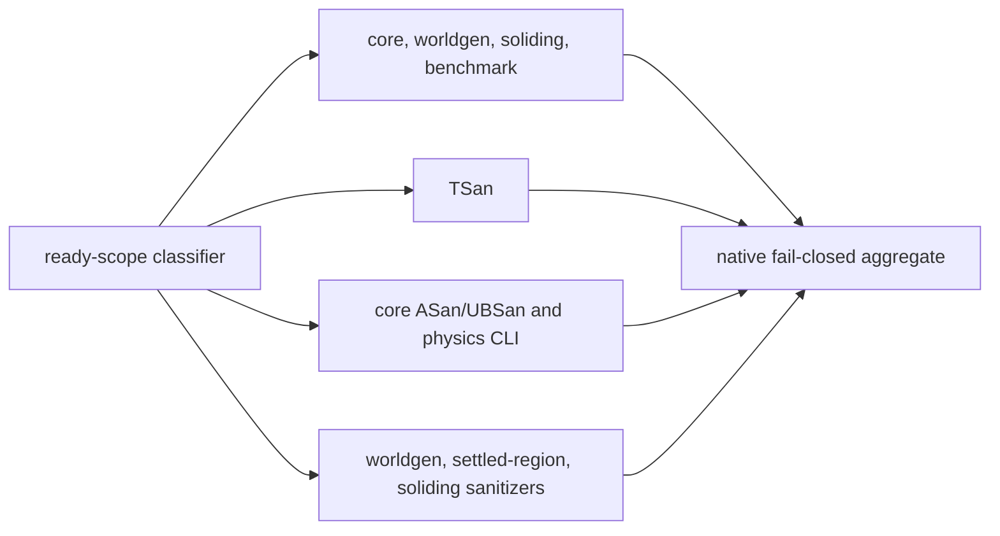

# Sandfall CI rehabilitation — 1 November 2026

## Source and ownership boundary

Implementation starts from Sandfall `main` at
`4a01a00d1f457576e1d911ef08c45b4c0aaf3347`, with frozen CyberSand ancestry
`1d376fb38ff5df83691e468baa0639270a5f40e6`. The work is isolated on
`ci/rehabilitate-workflows`. It does not change SF-M3 PR #5 or SF-M4 PR #6.
At initial inspection #5 targeted `main`, and #6 was stacked on #5. Their
workflow contracts and exact-head runs were read separately; neither branch is
part of this source tree or a qualification substitute for the CI changes here.

During implementation the feature owner pushed separate test corrections.
The live heads were #5 `744227deb015c3a87a79e55e0271d28c5e2d310b` and #6
`b57738eb128ab5a82f5153fee1ba4c093f3996c2`. At that read, Native, GDExtension
and SF-M3/SF-M4 Web runs `41288103233`, `41288103276`, `41288098937`,
`41288109405`, `41288109464`, and `41288106201` were still active. They belong
to the feature owner and were left undisturbed. PR #6 still named the earlier
M3 base `44f28cb6894803e4bf40ce329fcbf5d7eadd1fcd`; update its stack only after
the final M3 head is integrated.

The repository had no active branch protection rule for `main` at inspection.
No protection or required-check setting is changed by this work. Before any
integration, recheck the live rule, current `main`, open PR heads, approvals,
and all Actions runs.

## Measured baseline and diagnosis

Complete GitHub Actions job inventories were used for the cited runs, not the
default 30-job REST page.

| Workflow and run | Source | Runner jobs / peak | Runner queue | Active workflow wall | Runner-minutes | Outcome |
|---|---|---:|---:|---:|---:|---|
| Native [#62](https://github.com/techrote/sandfall/actions/runs/41261895552) | `44f28cb6894803e4bf40ce329fcbf5d7eadd1fcd` | 1 / 1 | 76.0m to first runner | 64m47s | 64.8 | success |
| Native [#63](https://github.com/techrote/sandfall/actions/runs/41261931071) | `da18a0eabbe9636a6295f503534bcc30214db3a3` | 1 / 1 | 81.6m to first runner | 83m14s | 83.2 | success |
| SF-M3 Web [#9](https://github.com/techrote/sandfall/actions/runs/41261890605) | `44f28cb6894803e4bf40ce329fcbf5d7eadd1fcd` | 10 / 8 | 14.8m | 20.7m | 56.3 | success |
| SF-M4 Web [#9](https://github.com/techrote/sandfall/actions/runs/41261786571) | `4070f8ee2792b85ebe154e17afc274a2b7261f8f` | 36 / 18 | 0.1m | 20.2m | 90.2 | success |
| SF-M4 Web [#8](https://github.com/techrote/sandfall/actions/runs/41242248563) | `939e074bdd619c9b0014ae3046c8ca4d670d5d74` | 36 / 4 | 46.6m | 63.2m | 89.8 | success |
| GDExtension [#63](https://github.com/techrote/sandfall/actions/runs/41261931165) | `da18a0eabbe9636a6295f503534bcc30214db3a3` | 9 runner jobs / 5 | 39.2m | 41.9m | 97.5 | failure |

Native #62/#63 each ran one job. That job serialized TSan, ordinary tests,
physics CLI sanitization, worldgen tests and sanitizers, soliding regressions,
ASan/UBSan, settled-region and soliding sanitizer builds, and required
benchmarks. In #63, major stages included TSan 15m40s, core tests 12m04s,
worldgen plus related work 11m48s, ASan/UBSan 15m16s, settled regions 11m20s,
and soliding sanitizers 11m43s. Independent CPU-heavy groups could not overlap.
The long first-run waits are queue time, not Native execution time.

The Web runs do not justify replacing their workflow model wholesale. SF-M3
already tests meaningful browser profiles in parallel. SF-M4 shares a fresh
export across its browser jobs; its 36-job total used 18 runners when capacity
was available, and saw long queue/active delays when only four were available.
No new global concurrency lock or per-test runner fan-out is introduced.

## Native design and inventory

`native.yml` now runs four substantial suites independently on Ubuntu-hosted
runners, followed by the stable job ID and check name `native`:

The aggregate requires every suite result to equal `success`; missing, failed,
cancelled, or skipped required suites fail. On `ready_for_review`, the API-backed
scope classifier must itself succeed and report that Native coverage is
required. Drafts remain suppressed. The final job runs after all dependencies
with `always()` so a failure cannot disappear behind normal dependency
short-circuiting. `native_aggregate.py` and its failure-path tests cover these
cases.

Job timeouts are 60 minutes for core, TSan and general sanitizers, 75 minutes
for specialized sanitizers, and five minutes for aggregation. Individual bounds
range from 15 to 45 minutes. Physics CLI and specialized sanitizer diagnostics
are retained even on failure. Compiler/linker versions and exact source are
recorded. There are four expensive jobs, not a runner per command; peak Native
parallelism is four. Identical sources are compiled again where sanitizer flags
and output identities differ. Cross-job cache sharing would weaken this simple
source/flag boundary without evidence of a safe speedup.

The machine-readable [Native inventory](../../tools/ci/native_validation_inventory.json)
enumerates workflow commands, C++ test sources, Make target prerequisites and
embedded Python validation recipes. Its test asserts each workflow command is
in its assigned job and that the Makefile still includes all 12 core sources,
nine worldgen tests in each normal/sanitized family, and eight soliding tests in
each normal/sanitized family. The C-header check, physics CLI, apparatus
negative/plan checks, benchmark smoke runs, shared library build and required
benchmark execution remain represented.

### Native requalification results

Baseline was 64m47s/83m14s on one runner. On exact implementation head
`33487fbf9a168dd7c299cd414367aff6d01f0fb4`, hosted Native run
[`41294046970`](https://github.com/techrote/sandfall/actions/runs/41294046970)
passed all four suites and the stable `native` aggregate:

| Suite | Actual runner duration | Start to completion |
|---|---:|---|
| TSan | 14m41s | 09:39:15–09:53:56 UTC |
| Core/worldgen/soliding/benchmarks | 11m36s | 09:39:15–09:50:51 UTC |
| Core and physics CLI ASan/UBSan | 16m55s | 09:39:15–09:56:10 UTC |
| Worldgen/settled-region/soliding sanitizers | 26m41s | 09:39:16–10:05:57 UTC |

Observed workflow wall was 27m01s (09:39:06–10:06:07 UTC), with the first
runner starting three seconds after run creation, four heavy jobs overlapping,
and about 70.1 total runner-minutes including readiness and aggregation. Against
the recorded 64m47s/83m14s single-job walls, this run's critical path was 58–68%
shorter. Total runner use remained near the 64.8m lower historical run and below
the 83.2m run. These are observed hosted runs, not a universal capacity guarantee.

The subsequent CI correction changes only Godot regression scope/cache,
Godot test expectations and documentation; it does not alter `native.yml`,
`native/**`, Make targets or the Native inventory. Under the requested stop
checkpoint, Native was not rerun at the later correction SHA; its latest exact
source result remains the successful `33487fb` run above.

## Web-first validation and platform scope

The new `web-acceptance.yml` triggers on its own workflow, the reusable SF-M2
workflow, and relevant Web application/build/test inputs in PRs and pushes to
`main`. It calls the established SF-M2 acceptance
workflow on the exact PR head SHA. It preserves the pinned Godot 4.7,
godot-cpp, Emscripten 4.0.20, Rapier assets, fresh native/Web export and
Godot tests, source/artifact verification, real Chromium input, two viewport/DPR
profiles, and the legacy 600-tick native/Rapier browser oracle. It also retains
separate ordinary UI and legacy coupling results; a browser build alone is not
acceptance. The SF-M2 workflow remains push-triggered on its milestone branch
and is now also reusable with `workflow_call`.

This mainline gate is the **compatibility Web** profile. It does not label that
run threaded. The architecture specification calls Threaded Web an additional,
separate export requiring cross-origin isolation and explicitly places full
compatibility-plus-threaded matrix qualification in SF-M5 release qualification.
SF-M0/M1/M2 history continues to distinguish compatibility, threaded,
unisolated-hosting and visual evidence. Branch-specific SF-M3/SF-M4 browser
workflows remain responsible for their exact feature additions; the new
mainline wrapper skips heads prefixed `sf-m3/` or `sf-m4/` to avoid duplicating
those matrices. Their current compatibility/threaded results are not proof that
this implementation's changed workflow code passed. Confirm release-threaded
qualification when SF-M5 is admitted.

The Web acceptance path and native/Linux path serve different evidence roles.
The Linux host-native GDExtension build and four sharded Godot regression groups
remain required. The shards use the machine-readable `sandfall-current` profile:
all discovered test cases run except two inherited desktop UI cases that conflict
with Sandfall's approved dedicated zero-player host. The exact exclusions and
replacement evidence are recorded in
[`godot_regression_profiles.json`](../../tools/ci/godot_regression_profiles.json);
unit tests fail if an exclusion becomes stale or a new case is silently omitted.
The default `full` profile still discovers and runs every legacy/current test.
These host tests build the extension for actual Godot integration checks; they
are not a Linux desktop release claim.

The initial run at `33487fb` established the source drift: the feature-launcher
test requires the deliberately absent `FeatureNavigation` autoload, and the
Tower-controller test targets `main.tscn` rather than Sandfall's
`sandfall_main.tscn`. Both full-profile tests remain available for diagnostic
use. Their current-product replacements are the Sandfall session/editor-input
tests and the required fresh browser acceptance with real input. Separate
source-aligned test fixes update the stale presentation-resolution and
workbench-main-scene assertions. The Godot 4.7 import also regenerated nine
tracked Sandfall class entries; that exact generated cache update is committed
so the strict post-test clean-tree check remains intact.

Windows cross-compilation and the complete Windows headless suite are preserved
behind the manual `windows_portability` input on `gdextension.yml`. The regular
Linux build and current Sandfall aggregate are still routine gates. Windows
portability remains available by dispatching the workflow with
`windows_portability=true`; it is not a browser-product release obligation.

This is not a deletion of the recent Windows failure. In historical GDExtension
run #63, Windows cross-compilation succeeded, while the retained desktop
controller regression failed four exact-once Tower input assertions after the
feature branch changed the test from `root.push_input` to
`Input.parse_input_event` with screen-coordinate conversion. The same affected
test failed in Linux shard 3 on the feature source. The failing behavior is in
legacy desktop Tower input code, outside Sandfall's browser-only product
surface; it is an application/test regression on those feature heads, not a
runner provisioning defect. Preserve those assertions and their Windows test
harness. Keep Linux host-native regression truthfully required, and leave the
feature failure with #5/#6 owners rather than altering their source or making
Linux failures advisory. The profile boundary applies only to Sandfall `main`:
when reconciling #5/#6, re-include any feature-owner controller/launcher tests
that their changed product surface still requires, or replace them with the
feature's actual-browser evidence after the owner resolves the failing test.

## Triggers, cancellation, artifacts and caching

`ci-validation.yml` runs on every `.github/workflows/**` change, installs and
checks the pinned actionlint 1.7.12 release, and validates every active workflow,
provider policy and Native inventory/aggregation contract. Expensive workflows
use their own exact workflow paths plus their source/build inputs: Native runs
for `native.yml` and native/Make inputs; GDExtension for `gdextension.yml` and
host/test inputs; Web for its wrapper/reusable workflow and Web inputs. Thus an
unrelated manual/research workflow edit gets static validation without also
starting all product suites. Provider policy remains unchanged. Manual workflow
investigations receive run-unique concurrency groups and are not cancelled by a
later dispatch. Routine same-ref PR/push runs can still cancel when superseded.
There is no repository-wide lock.

GDExtension's Windows input is manual only; physics stress inputs and the
serial-equivalence variable remain opt-in. Issue 49 remains narrowly scoped by
Water apparatus paths. Existing reusable source-matched Web artifacts are
downloaded only within the same run ID, and each browser job verifies source and
checksums. No untrusted cross-run artifact or mutable compilation cache is
introduced. Toolchain assets remain pinned or checksum-verified.

## Workflow inventory and disposition

| Workflow | Current purpose | Observed issue | Decision | Evidence | Replacement or improvement |
|---|---|---|---|---|---|
| `ci-validation.yml` | Validate Actions syntax, provider policy and Native contracts | No dedicated workflow syntax/inventory guard | **Add / retain** | Checksummed [actionlint 1.7.12](https://github.com/rhysd/actionlint/releases/tag/v1.7.12); focused unit suite | Runs on workflow, Makefile and CI-tool changes |
| `documentation.yml` | Frozen ancestry, provenance reconciliation, repository/docs checks | Manual dispatch shared a cancellable same-ref group | **Restructure** | Existing exact-head source/provenance steps | Manual run gets unique group; routine replacement still cancels |
| `gdextension.yml` | Fresh Linux host extension plus Godot regression shards | Windows portability consumed a routine job; inherited launcher/Tower tests no longer match the active Sandfall host | **Restructure** | Linux build artifact SHA checks; four Linux shards; #63 Windows build passed; current profile has two explicit, replacement-backed exclusions | Keep the current Sandfall Linux profile required; preserve the complete Windows/full regression path behind manual input |
| `issue49-water-apparatus.yml` | Scoped Current-Water/native apparatus acceptance | Manual diagnostic could be cancelled by same-ref run | **Restructure** | Exact path filter and retained apparatus-v2 tests | Preserve suite; unique manual group |
| `native.yml` | Native correctness, sanitizers and benchmarks | One 65–83 minute serial job | **Restructure** | Runs #62/#63; inventory and aggregation tests | Four parallel suites plus fail-closed stable `native` join |
| `mat003-c128-timing.yml` | Owner-admitted C128 paired formal timing | Up to 100 minutes and manual admission burden | **Optional / retain** | Manual-only registration and owner-authority inputs | Keep separate from routine product CI |
| `mat003-s2a.yml` | Admitted S2A paired timing | Up to 70 minutes; research admission | **Optional / retain** | Manual-only, no PR or push gate | Preserve registered experiment |
| `mat003-s2p-timing.yml` | Admitted S2P paired timing | Up to 100 minutes; research admission | **Optional / retain** | Manual registration and owner authority | Preserve registration and original evidence |
| `mat003-wclear-timing.yml` | Admitted WCLEAR paired timing | Up to 210 minutes; research admission | **Optional / retain** | Manual registration and owner authority | Preserve long-running study as explicitly dispatched |
| `physical-actor-stress.yml` | Actor timeout/paired-Rapier stress campaign | Long and intentionally non-routine | **Optional / retain** | `workflow_dispatch` and `workflow_call` only | Keep diagnostics out of ordinary PR gates |
| `physical-timeout-stress.yml` | Source-SHA-pinned timeout diagnosis | Long and intentionally non-routine | **Optional / retain** | Required immutable 40-hex source input | Dispatch only for a named diagnostic investigation |
| `rapier-bvh-build.yml` | Paired control/patched Rapier BVH builds | Expensive but only called by stress lane | **Optional / retain** | `workflow_call` only, pinned Rust/Godot inputs | Preserve as stress subworkflow |
| `lcb001-shared-contract-runtime-publication.yml` | Publish CyberSand shared-contract runtime | Guarded for `techrote/cybersand`; not executable for Sandfall | **Retire** | Repository guard and CyberSand branch/runtime names | Keep history, scripts and evidence; remove active Sandfall workflow |
| `lcb002-pressure-variants-runtime-publication.yml` | Publish CyberSand pressure variants | Same incompatible repository guard | **Retire** | `techrote/cybersand` guard | Historical publication remains in Git |
| `lcb003-application-host-runtime-publication.yml` | Publish CyberSand application-host runtime | Requires companion workspace/release inputs absent from Sandfall | **Retire** | Guarded repository and CyberSand branch names | Sandfall Web build/provenance remains in live gates |
| `lcb005-inertial-runtime-publication.yml` | Publish CyberSand inertial runtime | Same incompatible repository guard | **Retire** | `techrote/cybersand` guard | Preserve source and old run records |
| `lcb005-water-inertial-runtime-publication.yml` | Publish CyberSand Water inertial runtime | Same incompatible repository guard | **Retire** | `techrote/cybersand` guard | Preserve source and old run records |
| `release-hashes.yml` | Publish CyberSand runtime manifest hashes | Hashes companion runtime binaries and checks out a missing companion-workspace commit; not Sandfall Web release | **Retire** | Exact CyberSand runtime and workspace inputs | Keep history; no longer present as active Sandfall release CI |
| `sf-m0-immutable-retest.yml` | Replay retained source-bound 600-tick artifact in a real browser | Historical artifact intentionally frozen; not a fresh build | **Optional / retain** | Artifact identity and SF-M0 audit | Keep as explicit historical retest, never relabel as current build |
| `sf-m0-import.yml` | One-time frozen upstream history import, with write permission | Import is complete; active rerun path has write scope and is not product acceptance | **Retire** | Frozen ancestor is on current `main`; docs/provenance workflow checks exact ancestry | Preserve import script and source history; retire only the workflow trigger |
| `sf-m0-ordinary-view.yml` | Actual ordinary-browser input/viewport/pixel qualification | Milestone-specific; no current mainline PR trigger | **Optional / retain** | Dated ordinary-Web audit and source-bound harness | Keep as replayable historical visual/browser qualification |
| `sf-m0-web.yml` | SF-M0 compatibility export and actual 600-tick Rapier browser test | Branch-specific qualification, not current mainline | **Optional / retain** | SF-M0 audit preserves successful retest and earlier timeout | Keep exact source/artifact run history and manual replay |
| `sf-m1-web.yml` | SF-M1 host/input plus ordinary and legacy browser coverage | Milestone-specific and distinct from threaded-Web evidence | **Optional / retain** | SF-M1 source and browser artifacts | Keep as historical source-bound qualification |
| `sf-m2-development-fixture.yml` | Package pinned source/development inputs; expressly not acceptance | Manual fixture path is not a test result | **Optional / retain** | Workflow labels fixture as non-acceptance; no routine trigger | Keep isolated for reproducible developer setup; do not count as a gate |
| `sf-m2-web.yml` | Fresh M2 host/legacy exports, actual browser matrices and legacy coupling | Previously only milestone-branch push and manual | **Restructure** | Existing 7-job source/export/browser/legacy chain | Add `workflow_call`; check out exact PR head; called by mainline Web acceptance |
| `web-acceptance.yml` | Mainline compatibility-Web application acceptance | None existed for ordinary source PRs on `main` | **Add / retain** | Existing SF-M2 acceptance contract; source-matched fresh export | Trigger Web workflow and relevant app/build/test changes; skip M3/M4 heads with their own matrix |
| `web-demo.yml` | Old CyberSand demo from branch `web-demo-m11` and artifact run `34034700056` | Stale demo branch and pre-Sandfall artifact | **Retire** | Branch-only / manual trigger and obsolete artifact identity | Actual Sandfall browser acceptance now runs from current source |
| `web-toolchain.yml` | Old Web toolchain builder for `web-demo-m11` | Pins Emscripten 4.0.11, while current Sandfall Web gate pins 4.0.20 | **Retire** | Old branch and toolchain differ from Sandfall build | `sf-m2-web.yml` supplies pinned current exports |
| `sf-m3-web.yml` (PR #5 branch) | Stable-ID Rapier workshop, 16-body and actual-browser qualification | 10 jobs, peak 8; exact feature branch, not on `main` | **Preserve on branch; reconcile later** | Owner-started Web run `41288098937` and Native run `41288103233` passed on head `744227d`; GDExtension run `41288103276` failed its Linux controller shard and Windows headless | Keep its feature tests; do not duplicate with wrapper; reconcile shared CI after the final M3 head |
| `sf-m4-web.yml` (PR #6 branch) | ZIP projects, exhibitions, promotion and actual-browser qualification | 36 jobs, peak 18 in run #9; queue/active wall highly variable | **Preserve on branch; reconcile later** | Owner-started Native run `41288109405` passed on `b57738e`; Web run `41288106201` failed ordinary UI; GDExtension run `41288109464` failed Linux shard 3 and Windows headless; #9 20.2m active; #8 109.8m total with 46.6m queue | Keep actual Web coverage; preserve the current failures for the M4 owner and review matrix breadth/runner pressure during reconciliation |

Retired configurations are removed from `.github/workflows`; their scripts,
Git history, audit records and historical run evidence remain. Five LCB
publication flows were all guarded to another repository, and are not replaced
by Sandfall publication because Sandfall has no such desktop-runtime release
contract. Windows portability code and test harnesses are not deleted.

## Exact-head qualification and measured result

The first local workflow/scope qualification was performed on the implementation
branch before hosted runs:

- actionlint 1.7.12 passed for every workflow present after cleanup;
- `test_native_validation.py` passed eight inventory and aggregation tests;
- `test_ci_workflow_contract.py` passed six trigger, source identity and
  concurrency tests;
- provider policy passed and its six unit tests passed, for 20 focused tests;
- `git diff --check` passed.
- `check_m11_consistency.py` passed (18 records, 28 source hashes), and the
  retrieval evaluation reported hit@1 19/32, hit@k 32/32 and MRR@k 0.7589.
- `check_docs.py` still reports six missing expected-fact source references;
  `check_repository.py` reports those same six plus ten stale inherited desktop
  runtime input digests. Both error lists exactly match a detached worktree of
  baseline `main` at `4a01a00`; all removed-workflow links and the retired
  workflow retrieval source were corrected, so this change adds no documentation
  or runtime identity errors. Retain the six companion-workspace gaps and stale
  desktop provenance as inherited evidence.

### First ready exact-head regression outcome

At SHA `33487fbf9a168dd7c299cd414367aff6d01f0fb4`, ready-head GDExtension run
[`41294046979`](https://github.com/techrote/sandfall/actions/runs/41294046979)
passed the Linux build but failed all four Linux shards and the aggregate. The
recorded causes were:

- Shard 0's strict dirty-tree check saw the Godot 4.7 import add nine
  `Sandfall*` classes to tracked `godot/.godot/global_script_class_cache.cfg`.
- Shard 1 ran `test_presentation_controls` against stale 1920×1080 expectations;
  Sandfall's committed project/session contract is 1280×800 `canvas_items`.
- Shard 2 ran `test_worldgen_workbench` against a stale `feature_launcher.tscn`
  main-scene expectation; the current dedicated entry is `sandfall_main.tscn`.
- Shard 3 timed out in `test_feature_launcher` because it requires the deliberately
  absent `FeatureNavigation` autoload, then failed three assertions in the legacy
  `test_microscenario_controllers` Tower input section.

These failures are preserved as exact evidence, not treated as passing. The two
source-aligned assertion fixes keep the existing workbench and presentation
contracts. The profile manifest keeps the two inherited desktop tests in its
`full` set while replacing them in the required Sandfall profile with current
session/editor and real-browser tests. The tracked class cache is updated from
the exact pinned-engine diff, retaining the post-run dirty-tree assertion.

### Latest exact-head hosted results

The following results all ran at exact PR head
`33487fbf9a168dd7c299cd414367aff6d01f0fb4`:

| Workflow | Run | Result | Detail |
|---|---:|---|---|
| Native | [41294046970](https://github.com/techrote/sandfall/actions/runs/41294046970) | **Passed** | Four suites and fail-closed `native` aggregate; 27m01s wall, about 70.1 runner-minutes. Timing detail is recorded under Native requalification above. |
| CI validation | [41293995107](https://github.com/techrote/sandfall/actions/runs/41293995107) | **Passed** | Workflow syntax, policy and CI contract validation. |
| Documentation/provenance | [41294046957](https://github.com/techrote/sandfall/actions/runs/41294046957) | **Passed** | Existing six expected-fact source-reference gaps and ten inherited runtime digest gaps remain as baseline findings, not new regressions. |
| Web acceptance | [41294046982](https://github.com/techrote/sandfall/actions/runs/41294046982) | **Passed** | Fresh compatibility-Web build and actual-browser acceptance. |
| GDExtension | [41294046979](https://github.com/techrote/sandfall/actions/runs/41294046979) | **Failed** | Linux host build passed; Linux regression shards 0, 1, 2 and 3 failed, so the `linux x86_64` aggregate failed. Windows build/headless, physical stress and serial-equivalence were skipped by their configured opt-in controls. |

The GDExtension log establishes four causes at that source: shard 0 detected
nine class entries regenerated in the tracked Godot 4.7 global script cache;
shard 1 found obsolete 1920×1080 presentation expectations against the
1280×800 `canvas_items` project contract; shard 2 expected the inactive
`feature_launcher.tscn` instead of `sandfall_main.tscn`; shard 3 timed out on the
absent `FeatureNavigation` autoload in the inherited launcher test and also
failed three Tower-input assertions in the inherited microscenario test.
The first three are directly corrected by the exact cache update and
source-aligned assertions. The latter two are explicitly excluded only from
the required `sandfall-current` profile, remain runnable in `full`, and have
current session/editor-input and real-browser replacements. The reviewer
endorsed this product-scope boundary. Whether those replacements provide
sufficient continuing coverage must still be confirmed by the final hosted
profile run; the legacy Tower input failure's feature-branch mechanism remains
unresolved with the SF-M3/SF-M4 owners.

The correction commit after `33487fb` contains these test/cache/profile changes,
but it has not run on hosted CI. Therefore `33487fb` remains the latest
exact-head evidence, and the correction SHA must not be described as qualified.
The PR remains draft and unmerged at this checkpoint. Do not start an expensive
rerun under the stop instruction; record fresh exact-source results before
qualifying or integrating this PR.

## SF-M3/SF-M4 reconciliation checklist

1. **SF-M3 / PR #5 first:** after this CI change is reviewed and integrated,
   bring the resulting `main` CI workflow changes into `sf-m3/rapier-workshop-20261031`.
   Resolve `native.yml`, `gdextension.yml` and Web trigger conflicts in the M3
   branch; retain the stable `native` aggregate, `ci-validation.yml`, required
   Linux host build/shards, M3's actual-browser tests, and its own fresh export.
   The mainline wrapper intentionally skips the `sf-m3/` head, so M3's own
   source-matched compatibility/threaded matrices remain its Web acceptance.
   Re-run Native, CI validation, Documentation/provenance, GDExtension Linux,
   and all M3 browser/export jobs at the final M3 SHA. Owner GDExtension run
   `41288103276` on `744227d` failed Linux shard 0's
   `test_microscenario_controllers` with five Tower input assertions, including
   viewport targeting and exact-once click/Space/F9 delivery. Keep diagnosis
   with the feature diff; Windows portability being manual does not waive the
   Linux failure. Its Windows headless job also failed on that feature head;
   Native run `41288103233` passed on the same head, and this CI PR contains no
   feature fix.
2. **SF-M4 / PR #6 second:** only after #5's final merge SHA is its base, bring
   the integrated CI changes through the updated M3 stack into
   `sf-m4/projects-exhibitions-20261031`. Resolve the same workflow conflicts;
   keep SF-M4 ZIP/archive/presentation/Gallery browser evidence and its separate
   compatibility/threaded results. The wrapper skips `sf-m4/` too. Re-run the
   same shared gates plus all M4 project/archive/exhibition and actual-browser
   jobs on the final M4 SHA. Owner GDExtension run `41288109464` at `b57738e`
   failed Linux shard 3 on the same five Tower input assertions, and its Windows
   headless job also failed. Owner M4 Native run `41288109405` passed on that
   source. Its Web run `41288106201` failed ordinary UI 800×450 DPR1 while
   waiting for `Sandbox-blank-Edit-ready`; other workshop body sizes and Gallery
   cases passed. Preserve both failures for the M4 owner.
3. The `sandfall-current` profile applies to main's approved dedicated Sandfall
   host. Do not copy its two legacy desktop exclusions blindly into #5/#6:
   those branches must explicitly re-include relevant changed controller or
   launcher tests, or replace them with feature-specific current-browser tests.
   Their five-failure Tower result remains a required feature-branch blocker
   until the owner resolves it.
4. Recheck open reviews, target/base SHAs and active Actions before each
   integration. Do not copy SF-M3/SF-M4 application changes into this CI PR or
   make the required Linux gate advisory.
5. The historical M4 matrix's 18-runner peak and 110-minute contended example
   should be reviewed with the M4 owner when reconciling; preserve each distinct
   browser acceptance claim while avoiding duplicate current-source matrices.

## Review and guarded integration

The independent reviewer found no material blockers after checking inventory
parity, job dependencies, aggregation, permissions, artifact identity, trigger
filters, compatibility/threaded labels, stacked heads and runner usage. The
first pass identified stale Windows-required acceptance guidance and overly
broad expensive workflow triggers; both were corrected. The follow-up caught a
redundant provider-policy test path in the GDExtension filters; it was removed.
The final pass confirmed those changes and found no further material issues.
Keep the PR draft until all exact-head required checks and review conditions
are met; re-read `main`, branch protection, competing PR owners and active runs
immediately before any merge. Leave the PR draft/unmerged if a relevant failure
remains unresolved. Do not alter branch protection to force the outcome.
